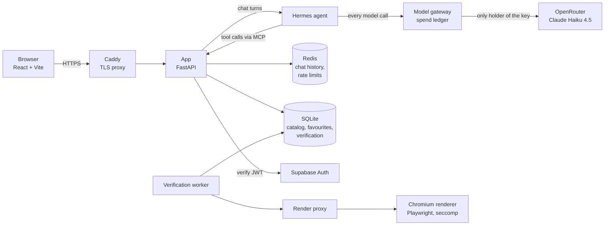

# CreedAI Business

**Helping small business owners pick the right AI tool, without the guesswork.**

Most small business owners know AI could save them time. What they don't have is the hours to read twenty pricing pages, figure out which tool fits a plumbing business versus a bakery, and work out whether "starts at $29" is real. CreedAI Business does that legwork for them.

You tell it what's slowing you down, in plain words. It shows you a short list of tools that fit your trade, what each one costs, and how to get started. Every fact on a tool card comes with a source link and the date it was last checked, so nothing is made up.

It also has an AI assistant called **Arkadio** that you can just talk to. Arkadio remembers your business, compares tools side by side, saves favourites to your account, and always answers from the verified catalog instead of guessing.

Built for the **UMD AI for Small Business Hack-a-thon, Fall 2026**, and running live on Azure.

- **Live app:** https://mainstreet-penny-aurin.belgiumcentral.cloudapp.azure.com
- **Built by:** Aurindom Mahanti (lead developer, built the backend, agent, infrastructure and most of the frontend) with hackathon teammates.

---

## What it does

**Task-first browsing.** You start from a problem ("customers don't come back", "I lose track of quotes"), not a list of software names. Problem cards lead to the tools that solve that problem for your trade.

**Facts with receipts.** Prices, free plans and key features are stored with the page they came from and the date they were checked. A background worker re-checks them on a schedule, and a sandboxed browser reads the live pricing page so stale facts get caught.

**Arkadio, the AI assistant.** A chat agent that:
- remembers your business name and what you do, across sessions when you're signed in
- answers from catalog data through tool calls, so prices and features are never invented
- compares tools in a table, saves favourites, and recalls them later
- handles messy, multi-part requests ("find me a booking tool and save it, and remind me what I saved last week")
- falls back to catalog answers if the model is paused or out of budget, so the app never just breaks

**Accounts.** Sign in with Supabase. Favourites and chat history belong to your account and nobody else's. Guests can browse everything and are asked to sign in only when they try to save something.

**Tool discovery.** When the catalog doesn't cover a need, a discovery worker can search for new candidate tools. New tools go through quarantine and verification before they ever reach a user.

---

## Architecture



The production stack is one Docker Compose file ([deploy/compose.prod.yml](deploy/compose.prod.yml)) with these services:

| Service | What it does |
|---|---|
| `proxy` | Caddy 2.10. Terminates TLS and is the only thing exposed to the internet. |
| `app` | FastAPI backend. Serves the API, the built frontend and the chat endpoint. |
| `actions` | The MCP server. Hermes calls it to look up tool details and pricing. It needs its own token and sits on the private network only. |
| `verification` | Background worker that re-checks tool facts against their source pages. |
| `render` + `render-proxy` | Headless Chromium (Playwright) with a seccomp profile, on internal-only networks, used to read pricing pages safely. |
| `gateway` | The model gateway. The only process that holds the provider API key. Every model call passes through it and is recorded in a SQLite spend ledger with a cost cap and a request cap. |
| `hermes` | The Hermes agent runtime (`nousresearch/hermes-agent`) that drives Arkadio's reasoning and tool calls. |
| `redis` | Redis 7.4. Stores account-scoped chat history (30 day retention) and rate-limit counters. |

Networks are split on purpose: `edge`, `private`, `render_api`, `render_back` and `frontend_auth`. The browser renderer can't reach the app's data, and nothing but Caddy faces the internet.

### How a chat turn works

1. The browser sends a message with the user's Supabase token.
2. The app verifies the token with Supabase, checks per-account rate limits (per minute and per day), and runs the input through a guard that blocks known prompt-injection and data-exfiltration patterns.
3. Simple catalog questions are answered straight from the catalog without a model call. That is faster and costs nothing.
4. Everything else goes to the Hermes agent. Hermes calls the model through the gateway and calls back into the app through an MCP server to look up tools, prices and the user's favourites.
5. A grounding check makes sure any price or feature in the reply matches the catalog. Tool cards, prices and table rows are built by the server, not written by the model.
6. If the model is unavailable, over budget, or a reply gets cut off, the app recovers (it retries once with a bigger output limit) or falls back to a clear catalog answer.

---

## Reliability, safety and cost

This started as a hackathon project, but it runs on a real server with real users, so it was built to fail safely.

- **One place holds the API key.** Only the gateway container knows the OpenRouter key. Hermes and the app never see it.
- **Spend is metered per call.** The gateway records every model call, its tokens and its cost in a SQLite ledger, and can refuse calls past a configured dollar or request cap.
- **Rate limits per account.** Per-minute and per-day message limits stop one user from running up the bill.
- **Guardrails.** Input checks for prompt injection in several languages, detection of card numbers, IBANs and credentials (with Luhn and IBAN validation) so they never reach the model, a leak guard that catches even a partial echo of a protected value, grounding so prices can't be invented, and tests mapped to the OWASP Top 10 for LLM applications.
- **Graceful degradation.** The chat badge shows Ready, Limited or Unavailable. When the AI is paused, browsing, saved tools and catalog answers keep working.
- **Safe deploys.** Releases go out as rolling container updates with a backup and a rollback image kept for every release. A release gate and an API canary run against the live site before a release counts as done.
- **Sandboxed browsing.** The renderer runs Chromium with a seccomp profile on isolated networks and only loads one page at a time.

---

## Tech stack

| Layer | Technology | Why it's here |
|---|---|---|
| Frontend | React 19, Vite 7, Tailwind CSS 4 | Fast to build, small bundle, works well on phones, which is where most owners will open it. |
| Auth | Supabase Auth (`@supabase/supabase-js`) | Ready-made sign in and JWTs. The backend verifies every token with Supabase before trusting it. |
| Backend | Python 3.11+, FastAPI, Pydantic 2, httpx, Uvicorn | Typed request and response models, async calls to the agent and gateway. |
| AI agent | Hermes agent (Nous Research) | Runs the multi-step reasoning and tool-calling loop for Arkadio. |
| Tool protocol | MCP (Model Context Protocol) | The agent reads catalog data and favourites through a token-protected MCP server instead of guessing. |
| LLM | Claude Haiku 4.5 via OpenRouter | Quick and cheap enough for chat, good at following tool schemas. |
| Model gateway | Custom FastAPI service + SQLite ledger | Holds the key, meters spend, caps cost and requests, recovers cut-off replies. |
| Data | SQLite | Catalog, favourites, verification results and the spend ledger. Simple, durable, no extra server to run. |
| Cache and sessions | Redis 7.4 | 30-day chat history and rate-limit counters. |
| Verification | Playwright + headless Chromium | Reads live pricing pages to keep facts fresh. |
| Proxy | Caddy 2.10 | Automatic HTTPS and a single public entry point. |
| Containers | Docker, Docker Compose | One file describes the whole production stack. |
| Cloud | Azure VM, provisioned with Bicep | Infrastructure as code in [infra/azure-vm.bicep](infra/azure-vm.bicep). |
| Testing | pytest, Node test runner, jsdom, Playwright e2e | Backend, frontend and real browser checks. |

---

## Testing

The project leans hard on tests because a chat agent is easy to break without noticing.

- **Backend:** about 1,600 pytest tests across 69 test files. They cover the agent turn, grounding, the gateway ledger, auth, favourites, rate limits, chat history, verification and OWASP LLM guardrails. Model calls are faked in tests, so the suite costs nothing to run.
- **Frontend:** 99 unit tests on the Node test runner with jsdom.
- **Grounding evals:** 30 labelled cases in [backend/evals](backend/evals) that check answers stay faithful to the catalog.
- **End to end:** Playwright scripts in [frontend/e2e](frontend/e2e) that drive a real browser through sign in, favourites and chat, at desktop and phone widths.
- **Live checks:** [scripts/release_gate.py](scripts/release_gate.py) and [scripts/api_canary.py](scripts/api_canary.py) run against the deployed site after a release.

---

## Run it locally

You need Python 3.11+ and Node 20.19+. No API key is needed to browse the catalog. The chat assistant needs an OpenRouter key and a running Hermes agent, so without them it falls back to catalog answers.

Keep test databases and the virtualenv outside the repo.

**Backend**

```bash
cd backend
python -m venv ../.venv
source ../.venv/bin/activate          # on Windows: ..\.venv\Scripts\activate
pip install -r requirements-dev.txt
cp .env.example .env                  # fill in only what you need
APP_DB_PATH=../dev.db python -m uvicorn app.main:app --host 127.0.0.1 --port 8000
```

Chat history and rate limits use Redis. To run one locally:

```bash
docker compose -f backend/compose.redis.yml up -d
```

**Frontend** (in a second terminal)

```bash
cd frontend
npm ci
npm run dev
```

Open http://127.0.0.1:5173.

**Tests**

```bash
cd backend && python -m pytest
cd frontend && npm test
```

---

## Deploying

Production runs on a single Azure VM.

1. Provision the VM with [infra/azure-vm.bicep](infra/azure-vm.bicep). An example parameters file sits next to it.
2. Copy [deploy/settings.env.example](deploy/settings.env.example) and [deploy/secrets.example](deploy/secrets.example) to real files on the server. Never commit the real ones.
3. Build and start the stack with [scripts/deploy_vm.sh](scripts/deploy_vm.sh), which uses [deploy/compose.prod.yml](deploy/compose.prod.yml).
4. Smaller app-only releases go out with [scripts/deploy_chat_hotfix.sh](scripts/deploy_chat_hotfix.sh), which backs up first and keeps a rollback image.
5. Run the release gate and the canary to confirm the live site is healthy.

---

## Repository layout

```
backend/
  app/              FastAPI app, chat, gateway, auth, favourites, verification, discovery
  app/agent/        Arkadio's agent layer: turn handling, grounding, guards, Hermes runtime, tool execution
  data/catalog.json Curated catalog: 24 tools, 19 trades, 7 categories, 12 problem cards
  evals/            Grounding evaluation cases
  tests/            pytest suite
frontend/
  src/              React app (catalog, tool cards, comparison, chat panel, favourites)
  tests/            Unit tests
  e2e/              Browser tests
deploy/             Dockerfiles, Caddyfile, production compose file, config examples
infra/              Azure Bicep template
scripts/            Deploy, release gate and canary scripts
demo/               Demo video script
PLAN.md             Product plan
```

---

## Status and honest limits

- This is a hackathon prototype that runs live. It is not a finished commercial product.
- The curated catalog is small on purpose (24 tools) so every fact can be checked. Discovery can add more, but new tools are quarantined until verified.
- The capacity counter is per process. Running several app servers would need a shared store first.
- The live URL may be taken down after the hackathon.

---

## Acknowledgements

Built for the UMD AI for Small Business Hack-a-thon, Fall 2026. Thanks to the teammates who contributed ideas, testing and code, and to the small business owners whose problems shaped the problem cards.
